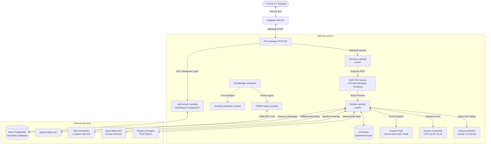

# Parali Mitra (पराली मित्र / ਪਰਾਲੀ ਮਿੱਤਰ) 🌾🚜

[](https://www.python.org/)
[](https://aws.amazon.com/serverless/)
[](https://aws.amazon.com/bedrock/)
[](https://neon.tech/)
[](https://t.me/alok8090bot)

> **AI-Assisted & Deterministic Crop Residue Management Platform on Telegram for Paddy Farmers in Punjab & Haryana.**

---

## 🔗 Live Deployments

| Component | Access Link | Description |
| :--- | :--- | :--- |
| **Telegram Bot (Farmer Interface)** | [t.me/alok8090bot](https://t.me/alok8090bot) | Primary trilingual (Hindi, Punjabi, English) voice & text conversational advisor |
| **Officer Residue Dashboard** | [Web Dashboard](https://6ojv2pkesl.execute-api.ap-south-1.amazonaws.com/dashboard) | Live spatial monitoring of NASA FIRMS fire hotspots, CRM machinery clusters & coverage gaps |
| **API Health Check** | [Health Endpoint](https://6ojv2pkesl.execute-api.ap-south-1.amazonaws.com/health) | AWS API Gateway liveness probe endpoint |

---

## 📌 Problem & Solution

Every autumn post-harvest season, millions of tonnes of paddy straw (*parali*) across Northwest India are burned in open fields due to narrow 15–20 day sowing windows for wheat. This leads to severe air quality emergencies across the Indo-Gangetic Plain.

**Parali Mitra** eliminates stubble burning by giving smallholder farmers actionable, ranked, and economically viable alternatives:
1. **In-situ Management:** Super Seeder, Happy Seeder, Smart Seeder, and Chopper/Mulcher zero-till sowing.
2. **Ex-situ Commercialization:** Straw baling and direct sale/delivery to verified Compressed Biogas (CBG) plants, Biomass Power units, and Pellet manufacturers.

---

## 🚀 Key Architectural Pillars

### 1. The Golden Rule: Deterministic vs. Generative
* **Pure Python Engine (`src/engine`):** All financial metrics, rental rates, baling economics, statutory burning fines, transit distances (haversine), and weather buffer timelines are computed **100% deterministically**.
* **Zero Math Hallucination:** The Large Language Model (LLM) is strictly restricted to multilingual dialogue, user empathy, intent extraction, and structured tool calling. It **never** invents numbers or rates.

### 2. Trilingual Conversational Agent
* Powered by the **Strands Agents SDK** with **Amazon Bedrock** (Anthropic Claude 3.5 Sonnet / `zai.glm-5`).
* Full native support for **Hindi (`hi`)**, **Punjabi (`pa`)**, and **Indian English (`en`)**.
* Contextual session persistence in PostgreSQL with conversational memory across turns.

### 3. Voice Note Processing (STT & TTS)
* **Speech-to-Text (STT):** Ingests Telegram voice notes (`.ogg`/Opus) and transcribes using **Amazon Transcribe** (`hi-IN`, `pa-IN`, `en-IN`).
* **Text-to-Speech (TTS):** Generates natural voice responses using **Amazon Polly** Neural voices (`Aditi` for Hindi, `Kajal` for Indian English).
* **Privacy-First:** Audio files are stored ephemerally in S3 and deleted immediately post-transcription.

### 4. Verified Two-Sided Marketplace & Open Lender Network
* Connects farmers directly with Custom Hiring Centres (CHCs), industrial biomass buyers, and **peer-to-peer equipment lenders (`/lend`)**.
* Multi-actor booking state machine with operator notification (`PENDING_CONFIRMATION`), inline accept/decline flows, status tracking (`/status`, `/mybookings`), and 1–5 star rating feedback loops.
* **Peer-to-Peer Lender Feature (`/lend`):** Any local farmer or machine owner can list idle tractors/seeders with phone verification, rate guardrails, and admin review (`/admin`).

### 5. Officer Dashboard & Spatial Intelligence
* Integrates real-time active fire hotspot telemetry from **NASA FIRMS (VIIRS NRT)**.
* Evaluates equipment coverage gaps (`compute_gap`) to flag clusters devoid of nearby CRM machinery within operational radii.
* Zero-PII public APIs (`/api/summary`, `/api/gaps`, `/api/machines`, `/api/fires`).

---

## 🏗️ System Architecture



---

## 📂 Repository Structure

```text
Paral-Mitra/
├── CLAUDE.md                 # Engineering guidelines & architecture decisions log
├── README.md                 # Pitch, quickstart & system overview
├── pyproject.toml            # Project dependencies and tooling configuration
├── requirements.txt          # Python dependencies lockfile
├── .env.example              # Sample environment variable template
├── db/
│   └── migrations/           # Idempotent numbered SQL migrations (0001_init to 0004_lender)
├── infra/
│   └── template.yaml         # AWS SAM CloudFormation infrastructure template
├── src/
│   ├── engine/               # Pure deterministic math & ranking engine (NO LLM, NO AWS)
│   │   ├── economics.py      # In-situ costs, baling net profit & fine calculations
│   │   ├── schedule.py       # Weather feasibility & day-by-day operational simulator
│   │   ├── geo.py            # Haversine distance calculation & spatial 0.1° grid cells
│   │   ├── recommender.py    # Multi-criteria weighted option evaluation
│   │   └── hotspots.py       # Machinery coverage gap analysis (compute_gap)
│   ├── connectors/           # External HTTP API clients (httpx with retry & timeout)
│   │   ├── firms.py          # NASA FIRMS active fire satellite detections
│   │   ├── weather.py        # Open-Meteo 10-day agricultural weather forecast
│   │   ├── geocode.py        # OSM Nominatim geocoding with 1 req/sec rate limiting
│   │   └── ingest_fires.py   # Automated active fire ingestion pipeline with TTL
│   ├── agent/                # Strands Agents SDK definitions, Bedrock tools & prompts
│   │   ├── tools.py          # Strict typed tool adapters over engine and connectors
│   │   ├── memory.py         # Session history persistence (sliding window)
│   │   └── prompts.py        # Trilingual empathetic system prompts
│   ├── bot/                  # Telegram webhook parsing, keyboards, flows & i18n
│   │   ├── router.py         # Update deduplication & conversational dispatcher
│   │   ├── keyboards.py      # Location request and interactive inline keyboards
│   │   ├── i18n.py           # Trilingual string catalogs (Hindi, Punjabi, English)
│   │   ├── flows/            # Modular state machine dialog flows
│   │   │   ├── farmer.py     # Farmer onboarding, /options, and /machines
│   │   │   ├── lender.py     # P2P equipment owner registration wizard (/lend)
│   │   │   ├── owner.py      # CHC operator and industrial straw buyer portal (/owner)
│   │   │   ├── admin.py      # Provider verification and approval (/admin)
│   │   │   └── booking.py    # Two-sided booking loop & ratings
│   │   └── local_polling.py  # Local getUpdates development runner (no webhook needed)
│   ├── handlers/             # AWS Lambda entry points
│   │   ├── receiver.py       # Ultra-lean webhook validator & SQS enqueuer
│   │   ├── worker.py         # Asynchronous update processor & agent orchestrator
│   │   ├── sweeper.py        # 24-hour unacknowledged booking expiry sweeper
│   │   └── api.py            # Officer dashboard HTML renderer & JSON API handler
│   └── common/               # Shared models, Neon PostgreSQL client & typed constants
├── data/
│   └── seed/                 # Ground truth data (verified CHCs, buyers, statutory rates)
├── scripts/                  # Management, migration, seeding & deployment scripts
│   ├── migrate.py            # Execute pending PostgreSQL migrations
│   ├── seed.py               # Ingest CSV registries into PostgreSQL
│   ├── build_lambda.py       # Cross-compile arm64 Lambda dependency wheels
│   ├── deploy.py             # One-command AWS SAM deployment helper
│   ├── set_webhook.py        # Register Telegram webhook with API secret token
│   └── db_check.py           # Database connectivity & latency diagnostics
└── tests/                    # Comprehensive Pytest suite (190+ unit & contract tests)
```

---

## 💬 Bot Commands & Interactions

| Command | Category | Description |
| :--- | :--- | :--- |
| `/start` | Farmer | Welcome onboarding, language selection (हिन्दी / ਪੰਜਾਬੀ / English), and location sharing |
| `/options` | Farmer | Calculate deterministically ranked residue solutions (costs, deadlines & earnings) |
| `/machines` | Farmer | Browse nearby verified machinery with lender badges, star ratings, and terms |
| `/mybookings` | Farmer / Operator | View real-time status of submitted requests or incoming operator jobs |
| `/lend` | P2P Owner | List idle equipment for nearby farmers with phone verification and rate guardrails |
| `/owner` | CHC / Buyer | Portal for registered Custom Hiring Centres and industrial straw off-takers |
| `/admin` | Administrator | Review and approve/reject pending provider and lender registrations |
| `/language` | General | Switch preferred language between Hindi, Punjabi, and English at any time |
| `/status` | Farmer | View profile overview (farm acreage, sowing deadline, location coordinates) |
| `/reset` | Farmer | Reset farm parameters to start optimization afresh |
| `/forget_me` | Privacy | GDPR-compliant permanent deletion of all personal data from the database |
| `/help` | General | Display commands guide and helpline information |

Farmers can also **send voice notes** in their native dialect or **type naturally** in Hindi, Punjabi, or English.

Farmers can also **send voice notes** in their native dialect or **type naturally** in Hindi, Punjabi, or English.

---

## 🛠️ Local Development & Setup

### 1. Prerequisites
- Python 3.12+
- `uv` (recommended) or standard `pip`
- Git

### 2. Clone & Install Dependencies
```bash
git clone https://github.com/Alok-Kumar2005/Paral-Mitra.git
cd Paral-Mitra

# Create and activate virtual environment
uv venv
.venv\Scripts\activate   # Windows
# source .venv/bin/activate # macOS/Linux

# Install dependencies
uv pip install -r requirements.txt
```

### 3. Configure Environment Variables
Copy `.env.example` to `.env` and fill in your credentials:
```bash
cp .env.example .env
```
Key variables:
- `TELEGRAM_BOT_TOKEN`: From [@BotFather](https://t.me/BotFather)
- `TELEGRAM_WEBHOOK_SECRET`: Secure random string for webhook verification
- `DATABASE_URL`: Neon PostgreSQL connection string (or use `DATABASE_MODE=local`)
- `FIRMS_MAP_KEY`: NASA FIRMS API key
- `MODEL_ID`: Amazon Bedrock model (`anthropic.claude-3-5-sonnet-20241022-v2:0` or `zai.glm-5`)
- `AWS_REGION`: `ap-south-1`

### 4. Database Setup & Seeding
```bash
# Apply SQL migrations
python scripts/migrate.py

# Ingest verified machinery and buyer seed data
python scripts/seed.py
```

### 5. Running the Bot Locally (Long Polling)
You don't need a public HTTPS domain or AWS deployment to test the bot locally:
```bash
python -m src.bot.local_polling
```

### 6. Interactive Terminal CLI
Test the recommendation agent and dialogue directly from your terminal:
```bash
python -m src.agent.cli
```

### 7. Run Unit & Contract Tests
```bash
pytest -v
```

---

## ☁️ Production Deployment (AWS SAM)

Parali Mitra deploys serverlessly to AWS `ap-south-1` using AWS SAM:

```bash
# 1. Build cross-compiled Lambda packages (arm64)
python scripts/build_lambda.py

# 2. Deploy infrastructure via AWS SAM
python scripts/deploy.py

# 3. Register Telegram Webhook
python scripts/set_webhook.py --url https://<your-api-id>.execute-api.ap-south-1.amazonaws.com/telegram/webhook
```

---

## 📄 License
This project is licensed under the Apache 2.0 License.
